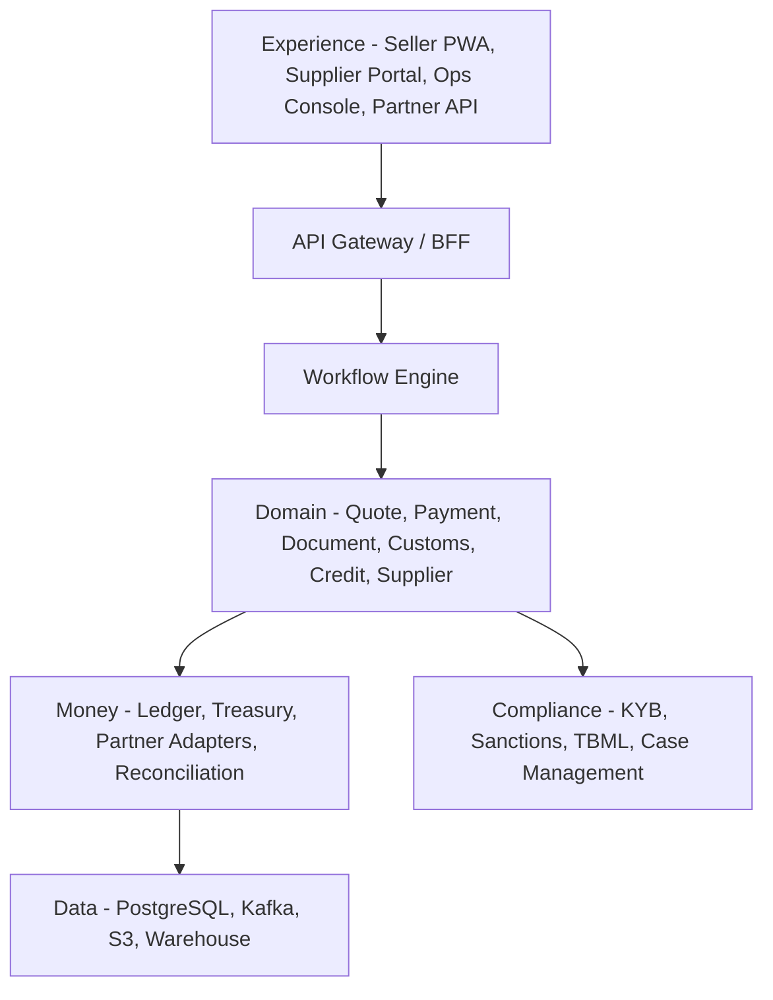
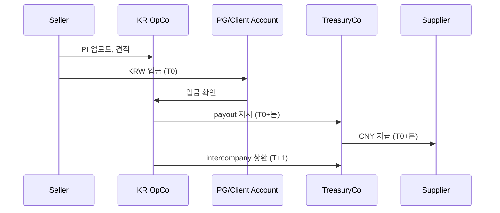
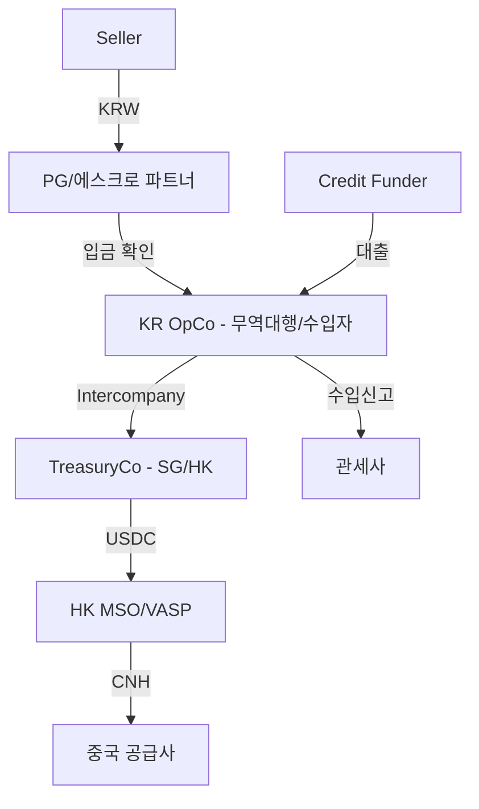

# Trade OS — 타겟 아키텍처

**버전** 1.0 · **작성일** 2026-11-09  
**한 줄** "1688 사입 셀러가 공장 PI를 올리면, 한국 도착 원가를 확인하고, 1탭으로 결제·통관·세무·30일 외상까지 끝내는 B2B 무역 정산 OS."

---

## 0. 범위와 원칙

### 0.1 이 문서의 범위

- "모든 국경 간 무역"이 아니라 **중국 1688 → 한국 셀러** 한 corridor, **K-beauty/액세서리** 한 vertical을 겨냥한다.
- 결제 레일은 파트너(XTransfer/은행/VASP)를 쓰고, 우리는 **문서·통관·세무·신용·공급사 그래프**를 소유한다.
- 크립토는 백엔드 정산에만 쓰고, 고객/공급사 UI에는 노출하지 않는다.

### 0.2 다섯 가지 원칙

| # | 원칙 | 아키텍처 함의 |
|---|---|---|
| 1 | **결제는 파트너, 운영은 우리** | 레일은 commodity. 문서·통관·신용이 해자 |
| 2 | **Invisible crypto** | 고객은 KRW, 공장은 CNY. USDC는 TreasuryCo 내부에만 |
| 3 | **Document-bound money** | 모든 payment는 document_hash를 가진다 |
| 4 | **한국 법인은 크립토를 만지지 않는다** | KR OpCo ↔ TreasuryCo 분리 |
| 5 | **Client funds segregation** | PG/에스크로 파트너가 고객 자금 보관 |

---

## 1. 문제와 wedge

### 1.1 현재 시장

| 경로 | 비용 | 시간 | 문서 | 신용 |
|---|---:|---|---|---|
| 1688 결제대행(결제만) | 2~5% | 1~3일 | 인보이스 선택 | 없음 |
| 1688 풀서비스(검수·통관·배송) | **6~11%** | 2~5일 | 대행사 | 일부 |
| 은행 TT | 1.5~3% + 1.5~3만 원 | 1~3일(신규 1~3주) | 셀러 | 없음 |
| 정식 무역대행 | 3~11% | 2~5일 | 대행사 | 일부 |
| 그레이 브로커/환치기 | 1.5~3% + 리스크 | 1~3일 | 없음 | 없음 |
| XTransfer | 0.4% + FX | 1~3일 | 없음 | 없음 |

**핵심: 결제만 보면 이미 commoditized다.** XTransfer 0.4% + FX, 결제대행 2~5%. 우리가 "더 싼 송금"으로 이길 수 없다.

**우리가 이기는 지점:**
- 6~11% 풀서비스 번들이 **불투명**하고 **데이터가 없고**, **30/60일 신용을 안 준다**.
- 셀러의 구매 결정 언어는 "수수료"가 아니라 **"한국 도착 원가"**와 **"다음 주문 가능한 현금"**이다.

### 1.2 wedge

> **"1688 사입 셀러의 랜딩 코스트 체크아웃 + 30일 외상."**

- 랜딩 코스트: 상품가 + FX + 관세 + 부가세 + FTA + 물류 + 검수 + 신용.
- 30일 외상: 결제 데이터·통관 데이터·마켓플레이스 정산으로 언더라이팅.
- 공급사: KYB·에스크로·검수로 신뢰.
- 결제: 파트너 레일로 1일 이내.

### 1.3 왜 지금

1. **2026-12-03 외환거래법 개정**: 국경 간 가상자산 이전이 '가상자산이전업무' 등록제로 편입. 등록 VASP/파트너 구조가 필수 → **합법 rails + 컴플라이언스 해자.**
2. **결제의 commoditization**: XTransfer 0.4% + FX. → 가치는 무역 운영·신용으로 이동.
3. **1688/Temu/AliExpress 습관화**: 한국 셀러의 소싱이 온라인화.
4. **한국 이커머스 마진 압박**: 30/60일 신용 수요.
5. **AI 에이전트**: 구매·결제·검수가 API로 자동화 → Trade OS가 실행 레이어.

---

## 2. ICP

| 항목 | 정의 |
|---|---|
| **핵심 ICP** | 한국 법인 셀러, 연매출 10~100억, 1688/공장 직거래, 월 10~30회 결제, 현재 결제대행/무역대행 사용 |
| **구매자** | 대표/CFO. 구매팀이 아니라 대표가 직접 결제·통관을 챙기는 조직 |
| **트리거** | B2B 납품처의 세금계산서 요구, 아마존/쿠팡 확장, 은행 대출·정부 지원 서류, 대행사 사고, 물량이 수동 처리 한계를 넘음 |
| **Anti-ICP** | 취미 셀러, 세금 회피가 이익의 원천인 셀러, 은행·관세사·값싼 신용을 가진 대형 수입사 |

---

## 3. 제품 표면

### 3.1 Seller (Web/PWA)

| 화면 | 기능 | 핵심 가치 |
|---|---|---|
| Home | 이번 주 결제할 PI, 랜딩 코스트, 현금 runway | "다음 주문 가능한가?" |
| Quote | PI 업로드 → OCR → 원가 분해, FX 10분 락 | "한국 도착 원가" |
| Checkout | KRW 가상계좌/카드, passkey 승인 | 1탭 결제 |
| Track | 결제→생산→선적→통관→입고, ETA | "언제 오나?" |
| Documents | 인보이스, BL, 수입신고서, 세금계산서 | "서류가 있다" |
| Credit | 한도, 사용, 상환, 30/60일 | "현금이 돈다" |

### 3.2 Supplier (Link/Portal)

| 화면 | 기능 | 핵심 가치 |
|---|---|---|
| Invite | 링크 가입, KYB, 계좌, 수출권 | 5분 온보딩 |
| Invoice | PI/인보이스 확인, 금액 확정 | 분쟁 예방 |
| Payout | CNY 수취, 상태 추적 | 24시간 입금 |
| Early Pay | 조기 지급, 할인율 | 현금 흐름 |
| Performance | 납기·품질·분쟁 점수 | 더 많은 바이어 |

**공급사 화면에는 `USDC`, `wallet`, `gas`가 없다.** 오직 `수취 금액`, `통화`, `입금일`만 있다.

### 3.3 Ops/Compliance Console

| 화면 | 기능 |
|---|---|
| Case Queue | KYB, 제재, TBML, 분쟁, payout 실패 |
| Payment Timeline | 견적→결제→payout→통관→정산 |
| Document Viewer | 원본, OCR, 해시, 버전 |
| Manual Override | 4-eyes 승인, 사유 기록 |
| Reconciliation | 파트너 명세, 은행, 원장 3-way |

---

## 4. 시스템 아키텍처

### 4.1 7개 레이어

| 레이어 | 구성 | 책임 |
|---|---|---|
| **Experience** | Seller PWA, Supplier Portal, Ops Console, Partner API | 사용자 경험, 인증, 입력 검증 |
| **Orchestration** | API Gateway/BFF, Workflow Engine(Temporal) | 사가, 재시도, 보상, 상태 전이 |
| **Domain** | Quote, Payment, Document, Customs, Credit, Supplier, Escrow | 업무 규칙, 도메인 상태 |
| **Money** | Ledger, Treasury, Partner Adapters, Reconciliation | 자금 이동, 원장, 대사 |
| **Compliance** | KYB/KYC, Sanctions, TBML, Travel Rule, Case Mgmt | 규제 준수, 리스크 |
| **Data** | PostgreSQL, Kafka/SQS, S3, Warehouse | OLTP, 이벤트, 분석 |
| **Platform** | Auth, RBAC, KMS, Observability, CI/CD | 보안, 운영, 배포 |

### 4.2 6개 모듈

| 모듈 | 기능 | Build/Buy/Partner |
|---|---|---|
| **Pay** | 견적, KRW 수금, USDC, 현지 payout, FX | Build orchestration, partner rails |
| **Prove** | 인보이스 OCR, 계약, 통관, 세무, 원산지 | Build + 관세사/세무사 |
| **Protect** | 에스크로, 검수, 분쟁, 보험 | Build logic + 파트너 |
| **Finance** | 30/60일 신용, 공급사 조기 지급 | Build underwriting + 펀딩 파트너 |
| **Predict** | 랜딩 코스트, FX 헤지, 수요 예측 | Build (데이터 해자) |
| **Program** | API, 에이전트, 임베디드 | Build |

### 4.3 컴포넌트 다이어그램

### 4.4 기술 스택 (권장)

- **Front**: Next.js/TypeScript, Tailwind, PWA.
- **Back**: NestJS(TypeScript) 또는 Go; PostgreSQL; Redis; Temporal; Kafka/SQS; S3.
- **Infra**: AWS ap-northeast-2(서울) + ap-southeast-1(싱가포르); EKS; Terraform.
- **Auth**: passkey/WebAuthn, OIDC, RBAC; ops는 SSO + 4-eyes.
- **Observability**: OpenTelemetry, Prometheus/Grafana, Sentry.

---

## 5. 자금 흐름과 원장

### 5.1 Prefunded Treasury 모델

**왜 이 구조인가**
- 셀러는 국내 KRW 이체만 한다. 해외 송금·외환 신고를 하지 않는다.
- TreasuryCo는 USDC 잔액으로 즉시 지급한다. 은행 wire를 기다리지 않는다.
- KR OpCo는 T+1에 상환한다. Float는 TreasuryCo가 부담하고, 그 비용은 수수료에 반영된다.
- 한국 법인은 크립토를 만지지 않는다.

### 5.2 Client Funds Segregation

- 셀러 대금은 PG 가상계좌/에스크로 파트너의 **분리 계좌**에 들어간다.
- 플랫폼은 지급 지시만 하고, 직접 보관하지 않는다.
- 수수료 수익은 일일 sweep으로 운영 계좌로 이동.
- 원장에서 `client_cash`와 `operating_cash`를 분리; 혼합 금지.

### 5.3 원장 예시 (설명용 단순화)

가정: 상품 $10,000, FX 1,350 KRW/USD, 수수료 1.8%, 관세 8%, 부가세 10%(설명용 단순화).

| # | 계정 | 차변 | 대변 |
|---|---|---:|---:|
| 1 | Client Cash (KRW) | 16,173,000 | |
| | Client Payable—Seller | | 16,173,000 |
| 2 | Client Payable—Seller | 16,173,000 | |
| | Client Payable—Supplier (USD 10,000) | | 13,500,000 |
| | Client Payable—Customs | | 2,430,000 |
| | Client Payable—Platform Fee | | 243,000 |
| 3 | Client Payable—Supplier | 13,500,000 | |
| | Client Cash / Treasury | | 13,500,000 |
| 4 | Client Payable—Customs | 2,430,000 | |
| | Client Cash | | 2,430,000 |
| 5 | Client Payable—Platform Fee | 243,000 | |
| | Revenue | | 243,000 |
| 6 | Operating Cash | 243,000 | |
| | Client Cash | | 243,000 |

**Agency 모델**에서는 셀러가 수입자(IoR)이므로 관세·부가세는 셀러가 직접 납부하고, 원장은 상품+수수료만 다룬다. **Principal 모델**에서만 위 전체 흐름이 발생한다.

### 5.4 Reconciliation

- **3-way**: 파트너 statement, 은행 statement, ledger.
- **자동 매칭**: 금액·통화·참조번호·시간.
- **예외 큐**: 금액 차이, 누락, 중복, 상태 불일치.
- **SLA**: 익일 10:00 KST까지 99% 매칭.

---

## 6. 법인·규제 구조

### 6.1 법인 구조

| 법인 | 역할 | 크립토 |
|---|---|---|
| **KR OpCo** | 무역대행/수입자, KRW 수금, 통관, 세금계산서 | **미보유** |
| **TreasuryCo (SG/HK)** | USDC 보유, 해외 payout, 파트너 계약 | 보유 |
| **Bank/PG** | 고객 자금, FX, 송금 | 미보유 |
| **Credit Funder** | 신용 제공 | 미보유 |

### 6.2 2026-12-03 외환거래법 개정

- 국경 간 가상자산 이전은 **'가상자산이전업무' 등록제**.
- 등록 VASP만 가능하고, 이전 내역을 외환정보집중기관에 보고.
- 따라서 **등록 VASP/해외지급결제업자와 제휴**하거나, 필요 시 직접 등록.
- **한국 법인은 크립토를 직접 만지지 않는다.** TreasuryCo가 해외에서 파트너와 정산.

### 6.3 Agency vs Principal

| 모델 | 수입자(IoR) | 매출 | 리스크 | 적용 |
|---|---|---|---|---|
| **Agency** | 셀러 | 수수료만 | 낮음 | Phase 0~1 |
| **Principal** | KR OpCo | 상품 매출(gross) | 재고·VAT·환율 | Phase 2~ |

- Phase 0은 **Agency**로 시작: 셀러가 수입자, 플랫폼은 서류·통관·결제를 대행.
- Phase 2부터 선택적 **Principal**: 통제력·데이터·마진이 크지만 재고/부가세 리스크.

### 6.4 법률 검토 오픈 이슈

1. 한국 외환거래법상 KR OpCo↔TreasuryCo intercompany 결제 구조.
2. 무역대행/대리 모델에서의 수입자 지위와 세금계산서 발행.
3. PG/에스크로 파트너의 고객 자금 보관 라이선스 범위.
4. 홍콩 MSO/VASP의 USDC→CNH 수행 범위.
5. 중국 수출환급·수출신고와 제3자 지급의 정합성.
6. 신용 제공 시 대부업/여신전문금융업 해당 여부.
7. 개인정보 국외 이전(PIPA)과 중국 PIPL.

---

## 7. 신용 엔진

### 7.1 상품

| 상품 | 대상 | 기간 | 가격 | 담보 |
|---|---|---|---|---|
| Seller Pay Later | 셀러 | 30/60일 | 1.5~2.5%/월 | 매출채권, 재고 |
| Supplier Early Pay | 공급사 | 즉시 | 1~2%/월(할인) | 인보이스, BL |

### 7.2 언더라이팅

- **데이터**: 결제 이력, 마켓플레이스 정산, 통관, 공급사 집중도, 분쟁률, 은행 거래, 신용평가.
- **모델**: 초기 규칙 기반 → 6개월 통계 → 12개월 ML.
- **한도**: 매출의 10~20%, 초기 최대 $50k; 성과에 따라 증액.
- **펀딩**: 은행/펀드 facility; true sale; first-loss 5~10%; 보험.
- **수금**: 자동이체, 마켓플레이스 정산 계정 통제, 담보, 법적 절차.

### 7.3 유닛 이코노믹스 (예시)

- 고객당 월 GMV $32k, 결제 1.5% = $480, 파트너 0.5% = $160, 결제 GM $320.
- 신용 30% × 1.5% = $144, SaaS $50.
- 총 기여 $514/월, CAC $2,000, payback 3.9개월.

---

## 8. 데이터·API

### 8.1 핵심 엔티티

| 엔티티 | 핵심 필드 |
|---|---|
| `seller` | id, business_no, tax_type, kyc_tier, status |
| `supplier` | id, country, currency, bank_account, export_right, kyc_tier |
| `invoice` | id, payment_id, currency, amount, hs_code, document_id |
| `quote` | id, seller_id, supplier_id, breakdown_json, fx_rate, expires_at |
| `payment` | id, quote_id, status, amount_usd, amount_krw, trade_model, idempotency_key |
| `payout` | id, payment_id, partner, currency, amount, status, tx_hash |
| `document` | id, type, hash, version, s3_key, ocr_json, confidence |
| `customs_declaration` | id, payment_id, declaration_no, duty, vat, status |
| `credit_line` | id, seller_id, limit, used, apr, status |
| `ledger_entry` | id, payment_id, account, debit, credit, currency |
| `partner_txn` | id, partner, type, amount, currency, status, ref |
| `case` | id, type, subject_id, assignee, status, sla |

### 8.2 API

| Method | Path | 설명 |
|---|---|---|
| POST | `/v1/quotes` | 랜딩 코스트 견적 |
| GET | `/v1/quotes/{id}` | 견적 조회 |
| POST | `/v1/payments` | 결제 생성 |
| GET | `/v1/payments/{id}` | 결제 상태 |
| POST | `/v1/payments/{id}/cancel` | 취소 |
| POST | `/v1/documents` | 문서 업로드 |
| POST | `/v1/suppliers` | 공급사 온보딩 |
| POST | `/v1/credit/lines` | 신용 신청 |
| POST | `/v1/webhooks` | 웹훅 등록 |

**이벤트**: `payment.funded`, `payout.settled`, `customs.filed`, `customs.cleared`, `credit.approved`, `dispute.opened`.

---

## 9. 90일 MVP

### 9.1 Phase 0: Concierge (0~3개월)

- **제품**: 코드 없음. 랜딩 페이지, 견적서, 수동 결제(은행/홍콩 OTC), 스프레드시트 원장.
- **목표**: 셀러 10명, 결제 30건, GMV $500k, take 2.5%, 손실 0.
- **검증**: 지불 의사, 원가 구조, 공급사 수용, 법률 경로.
- **Kill**: 5명 미만 지불 의사, GM <1%, 법률 의견 부정.

### 9.2 Phase 1: MVP (3~9개월)

- **제품**: 체크아웃, 인보이스 OCR, 견적 엔진, 공급사 온보딩, 기본 원장, 관세사 API, KRW 가상계좌.
- **목표**: 셀러 50명, 월 GMV $3M, take 2.0%, 손실 0.3%, 재구매 40%.
- **채용**: 엔지니어 2, 운영 1, 컴플라이언스 1.
- **파트너**: 은행, 홍콩 MSO, 관세사.
- **Kill**: CAC payback >9개월, payout 실패 >2%, 컴플라이언스 비용 >0.5%.

### 9.3 Phase 2: Credit (9~18개월)

- **제품**: 신용 한도(펀딩 파트너), 공급사 조기 지급, 에스크로/검수, 회계 연동.
- **목표**: 셀러 200명, 월 GMV $10M, take 1.8% + 신용 0.5%, 손실 0.2%, 재구매 60%.
- **자본**: Seed $3~5M, credit facility $10~20M.

### 9.4 KPI

- GMV, net revenue, take rate, gross margin
- CAC payback, repeat rate, churn
- loss rate, dispute rate, payout failure rate
- time-to-pay, supplier NPS, compliance false positive

---

## 10. 하지 말 것

- **토큰/코인 발행** — 규제·투기·신뢰 리스크. 필요하면 폐쇄형 포인트.
- **고객 지갑 UX** — 고객은 USDC를 볼 필요 없다.
- **VASP 라이선스 선행** — 파트너로 시작. 필요할 때 등록.
- **은행/카드사가 되기** — 라이선스 파트너를 오케스트레이션.
- **마켓플레이스** — 셀러-공급사 매칭은 별도 사업. 먼저 정산.
- **자체 대차대조표 대출** — 펀딩 파트너로 시작.
- **모든 corridor 동시 진입** — 중국 → 베트남 → 멕시코.
- **"아무 데이터" 수집** — 데이터 사업(D)은 별도 회사.

---

## 부록 A. 견적 예시

가정: 상품 $10,000, 운임/보험 $500, 관세 8%, 부가세 10%(과세표준 CIF+관세), 수수료 1.8%, FX 1,350, 신용 30일 1.5%.

| 항목 | USD | KRW |
|---|---:|---:|
| Goods | 10,000 | 13,500,000 |
| Freight/Insurance | 500 | 675,000 |
| CIF | 10,500 | 14,175,000 |
| Duty (8%) | 840 | 1,134,000 |
| VAT (10% of CIF+duty) | 1,134 | 1,530,900 |
| Platform fee (1.8%) | 180 | 243,000 |
| Credit cost (1.5%) | 150 | 202,500 |
| **Total** | **12,804** | **17,285,400** |

## 부록 B. 결제 상태

| 상태 | 의미 | 다음 |
|---|---|---|
| QUOTED | 견적 생성 | AWAITING_FUNDS, EXPIRED |
| AWAITING_FUNDS | 입금 대기 | FUNDS_RECEIVED, CANCELLED |
| FUNDS_RECEIVED | 입금 확인 | COMPLIANCE_REVIEW |
| COMPLIANCE_REVIEW | KYB/제재/TBML | PAYOUT_QUEUED, ON_HOLD, REJECTED |
| PAYOUT_QUEUED | 지급 대기 | PAYOUT_INITIATED |
| PAYOUT_INITIATED | 지급 시작 | PAYOUT_SETTLED, PAYOUT_FAILED |
| PAYOUT_SETTLED | 지급 완료 | DOCS_IN_PROGRESS |
| DOCS_IN_PROGRESS | 서류 처리 | CUSTOMS_FILED |
| CUSTOMS_FILED | 신고 완료 | CUSTOMS_CLEARED |
| CUSTOMS_CLEARED | 통관 완료 | CLOSED |
| CLOSED | 종료 | DISPUTED |
| DISPUTED | 분쟁 | REFUNDED, CLOSED |
