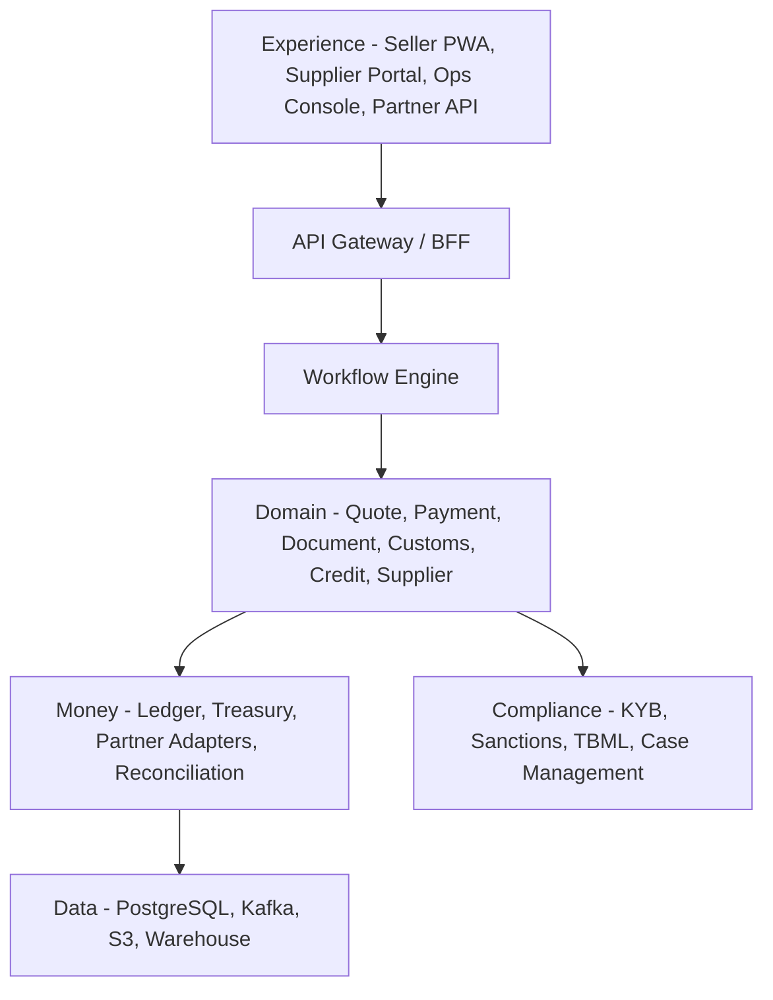
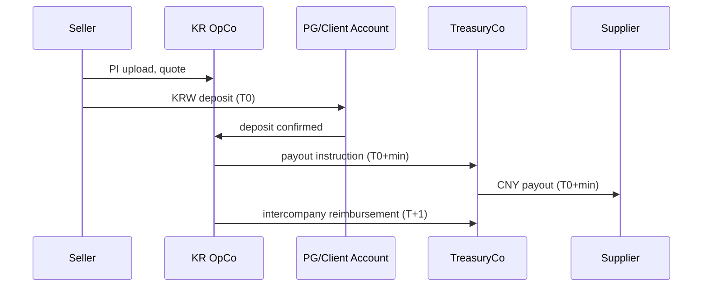
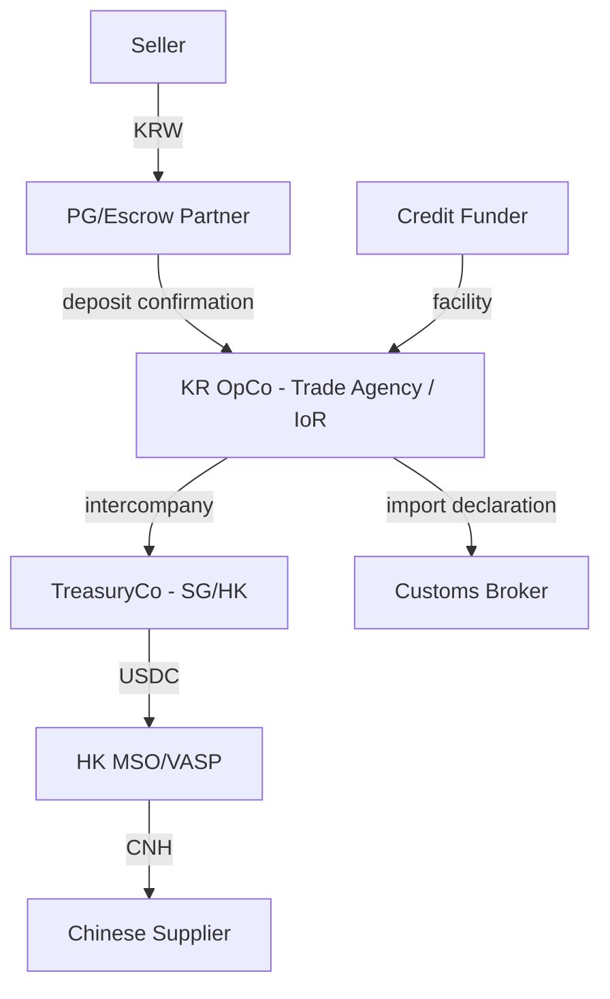

# Architecture

**Scope** Global architecture, corridor-config driven. First corridor: China → Korea. First vertical: 1688 K-beauty/accessories sellers. Wedge: landed cost + 30-day credit.

---

## 1. Principles

1. **Payments are a partner; we own the operating layer.** The rail is a commodity (XTransfer 0.4% + FX, banks, VASPs). Documents, customs, tax, supplier trust, and credit are ours.
2. **Invisible crypto.** The seller sees KRW; the factory sees CNY. USDC exists only inside the offshore treasury.
3. **Document-bound money.** Every payment carries a document hash. No document, no payment.
4. **The local operating entity never touches crypto.** In the first corridor, KR OpCo is a trade agency/importer of record; TreasuryCo is the offshore settlement entity.
5. **Client funds are segregated.** A PG/escrow partner holds customer money; the platform instructs, but does not custody.

---

## 2. System overview

### 2.1 Seven layers

| Layer | Components | Responsibility |
|---|---|---|
| **Experience** | Seller PWA, Supplier Portal, Ops Console, Partner API | UX, auth, input validation |
| **Orchestration** | API gateway/BFF, Temporal workflow engine | saga, retries, compensation, state transitions |
| **Domain** | Quote, Payment, Document, Customs, Credit, Supplier, Escrow | business rules, domain state |
| **Money** | Ledger, Treasury, Partner adapters, Reconciliation | fund movement, ledger, reconciliation |
| **Compliance** | KYB/KYC, sanctions, TBML, travel rule, case management | regulatory controls |
| **Data** | PostgreSQL, Kafka/SQS, S3, warehouse | OLTP, events, analytics |
| **Platform** | Auth, RBAC, KMS, observability, CI/CD | security, operations, deployment |

### 2.2 Six modules

| Module | What it does | Build / buy / partner |
|---|---|---|
| **Pay** | quote, KRW collection, USDC, local payout, FX | build orchestration; partner rails |
| **Prove** | invoice OCR, contracts, customs, tax, origin | build + customs broker/tax advisor |
| **Protect** | escrow, inspection, dispute, insurance | build logic + partners |
| **Finance** | 30/60-day credit, supplier early pay | build underwriting + funding partner |
| **Predict** | landed cost, FX hedging, demand forecast | build (data moat) |
| **Program** | API, agents, embedded | build |

### 2.3 Component diagram

### 2.4 Technology

- **Frontend:** Next.js/TypeScript, Tailwind, PWA.
- **Backend:** NestJS (TypeScript) or Go; PostgreSQL; Redis; Temporal; Kafka/SQS; S3.
- **Infra:** AWS ap-northeast-2 (Seoul) + ap-southeast-1 (Singapore); EKS; Terraform.
- **Auth:** passkey/WebAuthn, OIDC, RBAC; ops SSO + 4-eyes.
- **Observability:** OpenTelemetry, Prometheus/Grafana, Sentry.

---

## 3. Money flow

### 3.1 Prefunded treasury

**Why this structure**
- The seller only makes a domestic KRW transfer. No overseas remittance, no FX declaration by the seller.
- TreasuryCo pays from its USDC balance; it does not wait for a bank wire.
- KR OpCo reimburses T+1. The float is borne by TreasuryCo and priced into the fee.
- The Korean entity never holds crypto.

### 3.2 Client funds

- Seller funds land in a segregated PG/escrow account.
- The platform instructs; it does not custody.
- Fees are swept daily to the operating account.
- The ledger separates `client_cash` from `operating_cash`.

### 3.3 Ledger example (simplified)

Assumptions: goods $10,000, FX 1,350 KRW/USD, fee 1.8%, duty 8%, VAT 10% (simplified).

| # | Account | Debit | Credit |
|---|---|---:|---:|
| 1 | Client Cash (KRW) | 16,173,000 | |
| | Client Payable—Seller | | 16,173,000 |
| 2 | Client Payable—Seller | 16,173,000 | |
| | Client Payable—Supplier (USD 10,000) | | 13,500,000 |
| | Client Payable—Customs | | 2,430,000 |
| | Client Payable—Platform Fee | | 243,000 |
| 3 | Client Payable—Supplier | 13,500,000 | |
| | Client Cash / Treasury | | 13,500,000 |
| 4 | Client Payable—Customs | 2,430,000 | |
| | Client Cash | | 2,430,000 |
| 5 | Client Payable—Platform Fee | 243,000 | |
| | Revenue | | 243,000 |
| 6 | Operating Cash | 243,000 | |
| | Client Cash | | 243,000 |

In the **agency model**, the seller is the importer of record and pays duty/VAT directly; the ledger only handles goods + fee. The full flow applies to the **principal model**.

### 3.4 Why stablecoins are the enabler

A traditional trade agency needs a pre-funded bank account, a correspondent bank, and 3–5 days of settlement in every corridor. Trade OS uses one global USDC treasury:

- **One balance, many corridors.** TreasuryCo holds USDC and pays local partners in CNY/VND/MXN.
- **24/7 settlement.** No bank cut-off, no weekend gap.
- **Programmable escrow.** Milestone release and supplier early payment are code.
- **Lower prefunding.** The float is one global balance, not dozens of local accounts.

This is why the model can be global from day one. The rail is a commodity; the operating layer — documents, customs, tax, credit — is the moat.

---

## 4. Legal structure

### 4.1 Entities

| Entity | Role | Crypto |
|---|---|---|
| **KR OpCo** | trade agency/importer of record, KRW collection, customs, tax invoice | none |
| **TreasuryCo (SG/HK)** | USDC treasury, offshore payout, partner contracts | yes |
| **Bank/PG** | client funds, FX, outbound wires | none |
| **Credit funder** | provides credit capital | none |

### 4.2 Korea FX law (effective 2026-12-03)

- Cross-border virtual asset transfers become a registered **"virtual asset transfer business"** with reporting to the FX information center.
- Only registered VASPs can perform the business; unregistered operation is criminal.
- Therefore: partner with a registered VASP / overseas payment business, or register directly when volume justifies it.
- The Korean entity never touches crypto; TreasuryCo settles with licensed offshore partners.

### 4.3 Agency vs principal

| Model | Importer of record | Revenue | Risk | Phase |
|---|---|---|---|---|
| **Agency** | Seller | fee only | low | 0–1 |
| **Principal** | KR OpCo | gross goods revenue | inventory, VAT, FX | 2+ |

Start agency: the seller is the importer, the platform prepares documents and pays the supplier as agent. Move to principal selectively when control/data/margin justify the balance-sheet risk.

### 4.4 Open legal questions

1. FX law treatment of the KR OpCo ↔ TreasuryCo intercompany flow.
2. Importer-of-record status and tax invoice issuance in the agency model.
3. PG/escrow partner's license scope for holding client funds.
4. HK MSO/VASP scope for USDC → CNH.
5. China export VAT rebate and third-party payment consistency.
6. Lending license (대부업/여신전문금융업) for seller credit.
7. PIPA/PIPL cross-border data transfer.

---

## 5. Credit engine

### 5.1 Products

| Product | Target | Term | Price | Collateral |
|---|---|---|---|---|
| Seller Pay Later | seller | 30/60 days | 1.5–2.5%/month | receivables, inventory |
| Supplier Early Pay | supplier | immediate | 1–2%/month (discount) | invoice, BL |

### 5.2 Underwriting

- **Data:** payment history, marketplace payouts, customs records, supplier concentration, dispute rate, bank data, credit bureau.
- **Model:** rules → statistical → ML over 12 months.
- **Limit:** 10–20% of monthly GMV; initial max $50k; grow with performance.
- **Funding:** bank/fund facility; true sale; 5–10% first loss; insurance.
- **Collections:** auto-debit, marketplace payout control, collateral, legal.

### 5.3 Unit economics

- $32k monthly GMV per customer; payment 1.5% = $480; partner cost 0.5% = $160; payment GM $320.
- Credit 30% penetration × 1.5% = $144; SaaS $50.
- Total contribution $514/month; CAC $2,000; payback 3.9 months.

---

## 6. API and data model

### 6.1 Entities

| Entity | Key fields |
|---|---|
| `seller` | id, business_no, tax_type, kyc_tier, status |
| `supplier` | id, country, currency, bank_account, export_right, kyc_tier |
| `invoice` | id, payment_id, currency, amount, hs_code, document_id |
| `quote` | id, seller_id, supplier_id, breakdown_json, fx_rate, expires_at |
| `payment` | id, quote_id, status, amount_usd, amount_krw, trade_model, idempotency_key |
| `payout` | id, payment_id, partner, currency, amount, status, tx_hash |
| `document` | id, type, hash, version, s3_key, ocr_json, confidence |
| `customs_declaration` | id, payment_id, declaration_no, duty, vat, status |
| `credit_line` | id, seller_id, limit, used, apr, status |
| `ledger_entry` | id, payment_id, account, debit, credit, currency |
| `partner_txn` | id, partner, type, amount, currency, status, ref |
| `case` | id, type, subject_id, assignee, status, sla |
| `corridor_config` | id, currency, partners, docs, tax_rules, cutoff |

### 6.2 API

| Method | Path | Description |
|---|---|---|
| POST | `/v1/quotes` | create landed-cost quote |
| GET | `/v1/quotes/{id}` | get quote |
| POST | `/v1/payments` | create payment |
| GET | `/v1/payments/{id}` | payment status |
| POST | `/v1/payments/{id}/cancel` | cancel |
| POST | `/v1/documents` | upload document |
| POST | `/v1/suppliers` | onboard supplier |
| POST | `/v1/credit/lines` | apply for credit |
| POST | `/v1/webhooks` | register webhook |

**Events:** `payment.funded`, `payout.settled`, `customs.filed`, `customs.cleared`, `credit.approved`, `dispute.opened`.

---

## 7. Non-functional requirements

| Area | Target |
|---|---|
| Quote latency (p95) | <300ms |
| Payment API (p95) | <800ms |
| Payout webhook | <60s |
| Reconciliation | by 10:00 KST, 99% matched |
| Uptime | 99.9% |
| RPO/RTO | 15 min / 1 hour |

**Security:** PCI SAQ A (no card data), KMS encryption, RBAC + 4-eyes, append-only audit logs, annual pen test, SOC 2 roadmap.

**Failure modes:** bank/partner hold, payout partner outage, chain congestion, USDC depeg, supplier fraud, customs rejection, credit default, data breach. Each has a fallback and a runbook.

---

## 8. Roadmap

### 8.1 Global by design

The platform is multi-corridor by construction:

| Config | What changes | What stays |
|---|---|---|
| Currency | KRW, CNY, VND, MXN | ledger, quote engine |
| Partners | bank/PG, MSO, local PSP | adapter interface |
| Tax | duty, VAT, FTA | customs engine |
| Documents | invoice, BL, declaration | document engine |
| Cut-off | local banking hours | workflow engine |

Korea → China is the first config. Vietnam, Mexico, Indonesia, and Turkey are new configs + partners, not a rewrite.

| Phase | Timeline | Scope | Target |
|---|---|---|---|
| 0 | 0–3M | concierge, manual payments, spreadsheet ledger | 10 sellers, $500k GMV, 0 losses |
| 1 | 3–9M | checkout, OCR, quote, supplier portal, ledger, customs broker | 50 sellers, $3M/month |
| 2 | 9–18M | credit, escrow, second corridor | 200 sellers, $10M/month |
| 3 | 18–30M | partner API, multi-corridor, principal | 1,000 sellers, $30M/month |
| 4 | 30–36M+ | platform, agentic API, issuer partnership | $100M/month |

---

**KR 요약** — 첫 corridor에서 한국 법인(KR OpCo)은 무역대행/수입자로서 원화 수금·통관·세금계산서를 담당하고, 해외 TreasuryCo만 USDC를 보유한다. 동일한 구조를 다른 국가에서는 현지 법인 + 글로벌 TreasuryCo로 복제한다. 결제는 파트너, 문서·통관·세무·신용은 우리가 소유한다.
