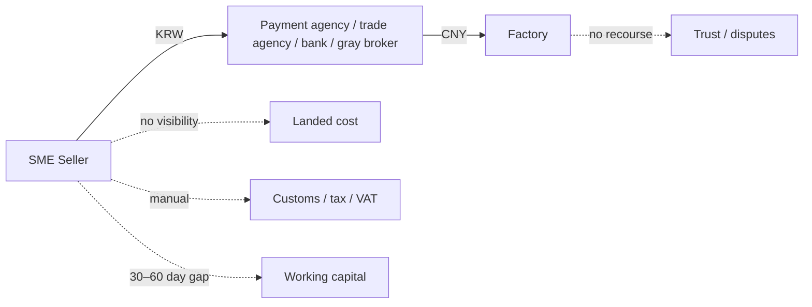
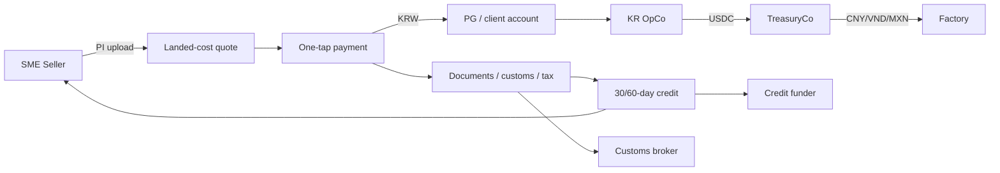
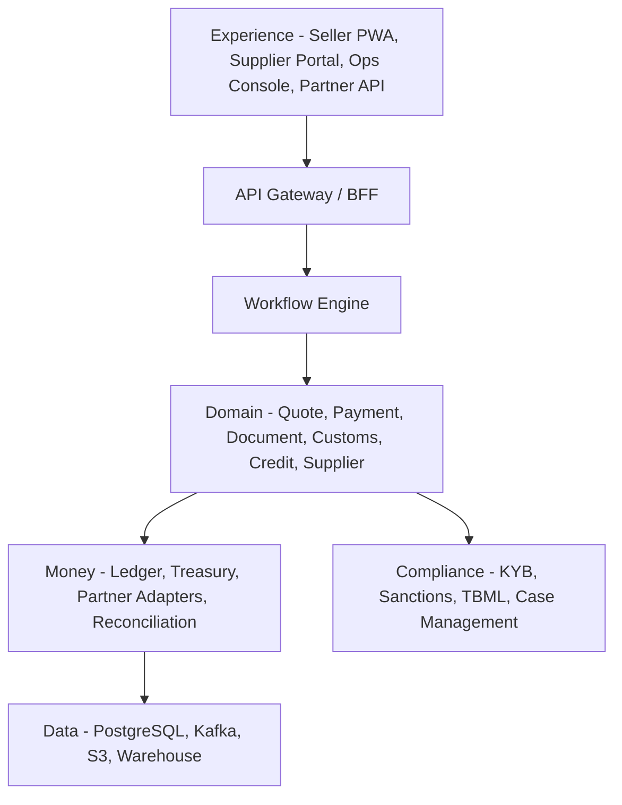
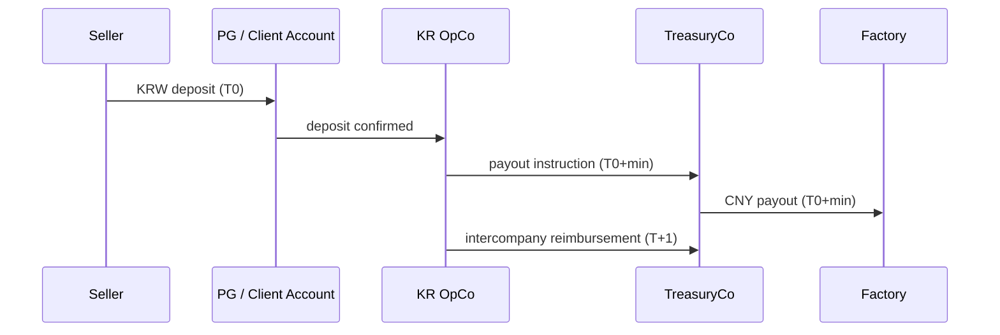

# Trade OS — Blueprint

**One-page thesis** Trade OS is the settlement and working-capital OS for global SME trade. A seller uploads a factory invoice, sees the true landed cost, pays in one tap, and gets customs/tax documents plus 30-day credit. The factory receives local currency. Stablecoins settle in the background. First corridor: Korea → China.

---

## 1. The problem in one picture



The seller buys a **bundle**, not a transfer: pay + clear customs + prove the import + recover VAT + finance the gap + trust the factory. Today the bundle is split across 4–5 providers, costs **6–11%**, and nobody owns the data.

**Payment alone is commoditized.** XTransfer moves money at 0.4% + FX. The unsolved layer is trade operations and credit.

---

## 2. The solution in one picture



**Five modules, one ledger:** Pay, Prove, Protect, Finance, Predict.

---

## 3. System blueprint



| Layer | Responsibility |
|---|---|
| Experience | seller, supplier, ops, partner API |
| Orchestration | saga, retries, compensation, state transitions |
| Domain | quote, payment, document, customs, credit, supplier |
| Money | double-entry ledger, treasury, partner adapters, reconciliation |
| Compliance | KYB/KYC, sanctions, TBML, case management |
| Data | OLTP, events, documents, analytics |
| Platform | auth, RBAC, KMS, observability, CI/CD |

---

## 4. Money flow blueprint



**Why stablecoins:** one global USDC treasury instead of a bank account per corridor; 24/7 settlement; programmable escrow; lower prefunding. The seller sees KRW; the factory sees local currency; the Korean entity never touches crypto.

---

## 5. Product blueprint

### 5.1 Seller journey

```
Home → Quote → Checkout → Track → Documents → Credit
```

| Step | What the seller sees | What happens behind |
|---|---|---|
| Home | upcoming PIs, cash runway | quote + credit engine |
| Quote | landed cost: goods, FX, duty, VAT, FTA, logistics, credit | HS/FTA/VAT rules, FX lock |
| Checkout | KRW virtual account, passkey | PG, payment saga, compliance |
| Track | payment → production → shipping → customs | partner events |
| Documents | invoice, BL, import declaration, tax invoice | document engine, broker |
| Credit | limit, draw, repay | underwriting, funding partner |

### 5.2 Supplier journey

```
Invite → KYB → Invoice confirmation → Payout / early pay
```

### 5.3 Ops console

```
Case queue → Payment timeline → Document viewer → Reconciliation
```

### 5.4 Quote screen (wireframe)

```
┌─────────────────────────────────────────────┐
│  Landed Cost                                │
│  PI: cosmetic packaging, PET, 50ml          │
│  Supplier: Guangzhou ...                    │
├─────────────────────────────────────────────┤
│  Goods            $10,000     ₩13,500,000   │
│  Freight/insurance   $500        ₩675,000   │
│  Duty 8%                        ₩1,134,000  │
│  VAT 10%                        ₩1,530,900  │
│  Platform fee 1.8%                ₩243,000  │
│  Credit 1.5%                      ₩202,500  │
├─────────────────────────────────────────────┤
│  Total                          ₩17,285,400 │
│  [ Pay in KRW ]   FX locked 09:58           │
└─────────────────────────────────────────────┘
```

---

## 6. Ledger and data blueprint

**Invariants**
- Every journal entry balances: sum(debits) = sum(credits).
- Client cash and operating cash are separate.
- No posting without `source_type` and `source_id`.
- No payout without a document hash.

**Core entities:** `seller`, `supplier`, `invoice`, `quote`, `payment`, `payout`, `document`, `customs_declaration`, `credit_line`, `ledger_entry`, `posting`, `partner_txn`, `case`, `corridor_config`.

---

## 7. Global corridor blueprint

| Config | What changes | What stays |
|---|---|---|
| Currency | KRW, CNY, VND, MXN | ledger, quote engine |
| Partners | bank/PG, MSO, local PSP | adapter interface |
| Tax | duty, VAT, FTA | customs engine |
| Documents | invoice, BL, declaration | document engine |
| Cut-off | local banking hours | workflow engine |

First corridor: Korea → China. Next: Vietnam → Korea, Mexico → US/Korea, Indonesia/Turkey → Korea. Each is config + partners, not a rewrite.

---

## 8. Twelve-month plan (summary)

| Phase | Timeline | Scope | Target |
|---|---|---|---|
| 0 | 0–3M | concierge, manual payments | 10 sellers, $500k GMV, 0 losses |
| 1 | 3–9M | checkout, OCR, quote, supplier portal, ledger | 50 sellers, $3M/month |
| 2 | 9–18M | credit, escrow, second corridor | 200 sellers, $10M/month |
| 3 | 18–30M | partner API, multi-corridor | 1,000 sellers, $30M/month |

---

## 9. YC scorecard

| Criterion | Trade OS |
|---|---|
| 10x improvement | 6–11% bundle → 2–4%; weeks → 1 day; 0 credit → 30/60 days |
| Invisible crypto | seller sees KRW; factory sees local currency; no wallet |
| Real revenue | 1.0–1.5% payment/docs + 1.5–2.5%/month credit + SaaS |
| Regulatory clarity | 2026-12-03 FX law registration; licensed VASP/bank partners |
| Market | $50B Korea SME import flow first; global SME trade next |
| Moat | supplier graph + customs/tax data + credit underwriting |
| Why now | payment commoditization, FX law, 1688 habit, margin pressure |
| Global | corridor-config driven; Korea → China is the first config |

---

## 10. What YC should remember

1. **The payment is not the product.** The landed cost, documents, and credit are.
2. **Crypto is why it is global.** One USDC treasury, 24/7 settlement, local payout in any corridor.
3. **Korea → China is the wedge, not the ceiling.** Every SME import corridor has the same 6–11% bundle and 30–60 day cash gap.

---

**KR 요약** — Trade OS는 전 세계 SME 수입업자의 사입 대금을 랜딩 코스트·통관·세무·30일 외상까지 한 원장에서 처리하는 B2B 무역 정산 OS다. 스테이블코인 글로벌 정산 레일로 corridor마다 복제하며, 한국-중국이 첫 번째 corridor다.
